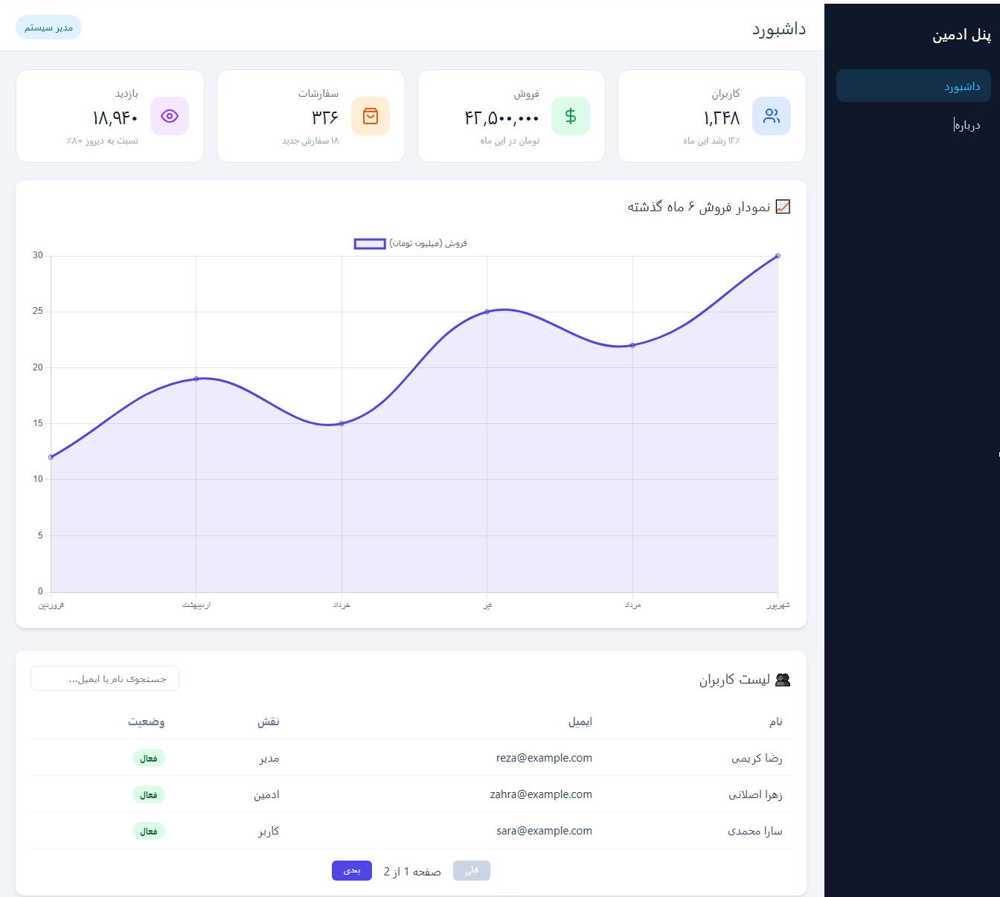

# Vue Admin Dashboard

A responsive, RTL-ready admin dashboard built with Vue 3, TypeScript, and Chart.js.

**Live demo:** https://vue-admin-dashboard-seven.vercel.app



## Features

- Interactive sales chart built with Chart.js
- Statistic cards (mock data)
- Data table with search, sorting, and pagination (client-side)
- RTL support for Persian language
- Responsive layout (CSS Grid and Flexbox)
- Component-based architecture (Layout, Sidebar, Header)
- Type-checked build (`vue-tsc`) to catch TypeScript errors before deployment

## Tech Stack

- Vue 3 (Composition API)
- TypeScript
- Vue Router
- Chart.js
- Vite
- CSS Grid / Flexbox

## Getting Started

**Requirements:** Node.js 22.18+ (or 24.12+)

```bash
git clone https://github.com/zahraslani/frontend-journey.git
cd frontend-journey/vue-admin-dashboard
npm install
npm run dev
```

Build for production:

```bash
npm run build
```

## What I Learned

- Structuring complex layouts with reusable Vue components
- Integrating a third-party library (Chart.js) into a Vue app
- Implementing client-side search, sorting, and pagination logic
- Writing type-safe code with TypeScript

## Notes

All data shown in the dashboard is mock data for demonstration purposes.